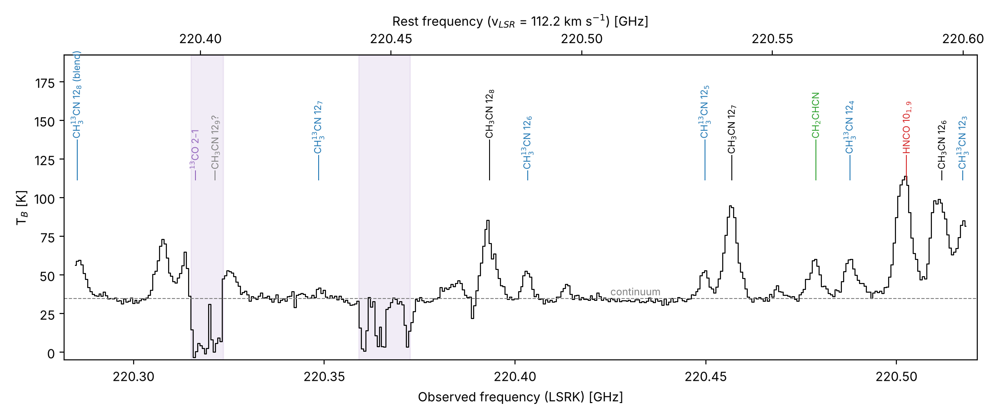
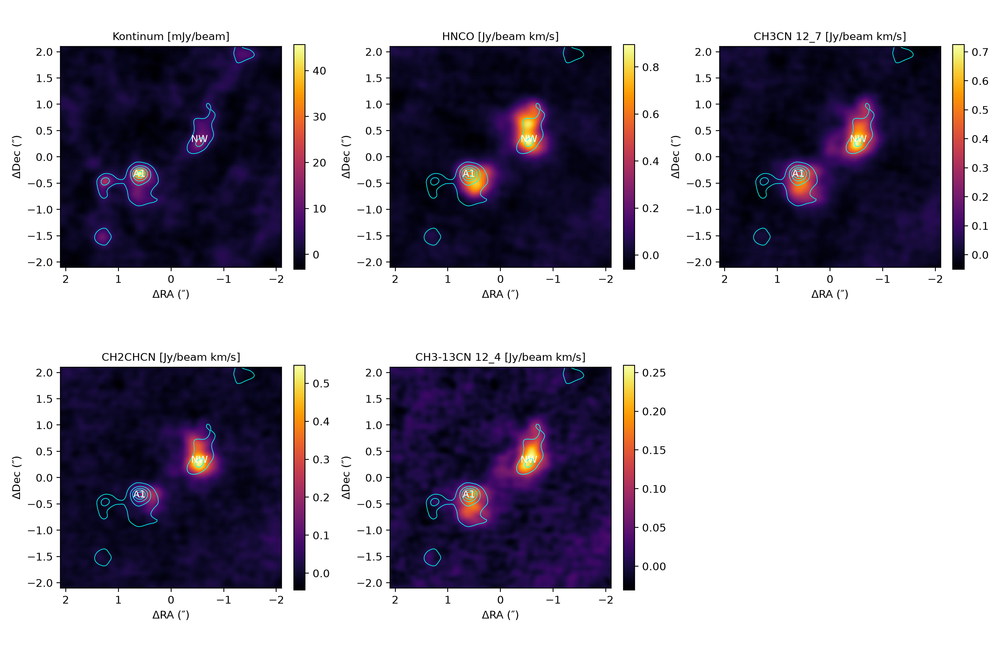

# Hot-core chemistry in G24.78+0.08 A1 and NW (ALMA Band 6)

Molecular line identification and physical conditions of two neighbouring hot cores in the
high-mass star-forming region G24.78+0.08, from one ALMA Band 6 spectral window (220.28–220.52 GHz).

**Report (paper format):** [`paper/G24_hotcore_report.pdf`](paper/G24_hotcore_report.pdf)



## Main results

| | A1 | NW |
|---|---|---|
| v_LSR (km/s) | 112.2 ± 0.5 | 109.3 ± 0.5 |
| T_rot (CH₃¹³CN) | 111 ± 14 K | 125 ± 11 K |
| τ (CH₃CN 12₆) | ≈ 4.6 | ≈ 4.7 |
| CH₂CHCN / CH₃¹³CN 12₄ | 0.83 | 2.0 |

- Five species identified: CH₃CN, CH₃¹³CN, HNCO, CH₂CHCN (tentative) and ¹³CO in absorption.
- Lines were identified interactively in CASA Viewer (blind search + candidate assessment) and
  matched systematically to the JPL/CDMS catalogues; both give the same species.
- Vinyl cyanide is concentrated almost entirely in NW, while temperatures are similar: the two
  cores differ chemically.



## Repository layout

```
casa/       CASA scripts (run with: casa --nogui -c <script>)
  01_extract_spectrum.py   import cube, find continuum peak, extract A1 spectrum
  02_mean_map.py           mean-intensity map
  03_spectrum_NW.py        spectrum of the NW core
  04_moment_maps.py        continuum subtraction and moment-0 maps
analysis/   Python analysis of the extracted spectra
  common.py                beam, unit conversion, line list
  find_peaks.py            continuum, rms and >3σ features
  fit_lines.py             Gaussian fits -> JSON
  rotation_diagram.py      T_rot, column density, optical depth
  make_figures.py          paper figures 1–3
data/       extracted spectra (specflux output) for A1 and NW
figures/    paper figures
paper/      report (PDF) and LaTeX source (A&A style)
```

## Reproducing the analysis

The spectra in `data/` are enough to reproduce Table 2, the rotation diagrams and Figures 1–3:

```bash
pip install numpy scipy matplotlib
cd analysis
python find_peaks.py ../data/spectrum_A1.txt --vlsr 112.2
python fit_lines.py ../data/spectrum_A1.txt --vlsr 112.2 --out fits_A1.json
python fit_lines.py ../data/spectrum_NW.txt --vlsr 109.3 --out fits_NW.json
python rotation_diagram.py fits_A1.json
python rotation_diagram.py fits_NW.json --exclude "CH3-13CN 12_5"
python make_figures.py fits_A1.json fits_NW.json
```

The CASA scripts need the original image cube
(`G24.78+0.08_BB_2_SPW_2.image.pbcor.fits`, 1.6 GB), which is not included here. It can be
obtained from the [ALMA Science Archive](https://almascience.org/aq/) under project code
**2013.1.00489.S**. Tested with CASA 6.7.6 under WSL (Ubuntu).

## Acknowledgements

This work makes use of the following ALMA data: ADS/JAO.ALMA#2013.1.00489.S. ALMA is a
partnership of ESO (representing its member states), NSF (USA) and NINS (Japan), together with
NRC (Canada), MOST and ASIAA (Taiwan), and KASI (Republic of Korea), in cooperation with the
Republic of Chile. The Joint ALMA Observatory is operated by ESO, AUI/NRAO and NAOJ.
The data were provided as part of a course assignment at Institut Teknologi Bandung.
Parts of the code and text were prepared with the assistance of an AI tool (Claude, Anthropic).

Author: Awal Jati Asmoro, Astronomy Study Program, Institut Teknologi Bandung.
